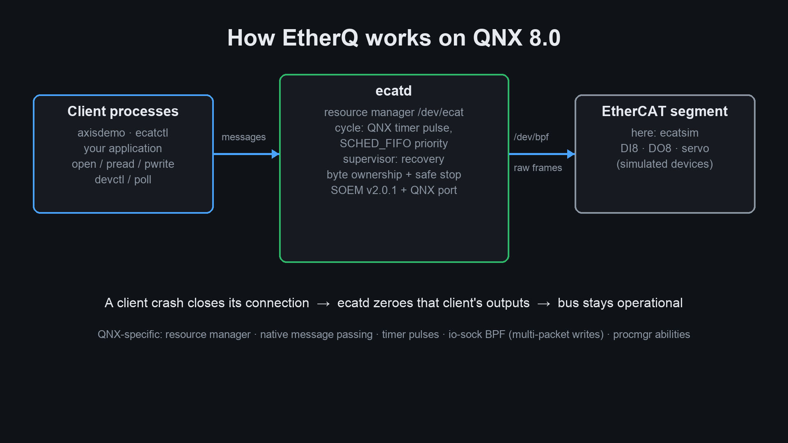

# EtherQ: EtherCAT for QNX OS 8.0, testable without hardware

EtherQ adds a **QNX OS 8.0 port of the SOEM EtherCAT master**. It turns the fieldbus into a **QNX resource manager** (`/dev/ecat`), so many isolated processes can share one real-time bus safely. It also ships **ecatsim**, a virtual EtherCAT segment, so the whole stack can be developed, demonstrated and tested in CI with no EtherCAT hardware.

- **Upstream:** [SOEM v2.0.1](https://github.com/OpenEtherCATsociety/SOEM), fetched by URL with a pinned SHA-256. It is not forked or vendored.
- **QNX version / target / toolchain:** QNX OS 8.0 (SDP 8.0, QNX Everywhere) · QEMU x86_64 (aarch64le toolchain file included) · `qcc` / `gcc_ntox86_64`
- **License:** GPL-3.0-or-later, because SOEM is GPLv3 / commercial dual-licensed.

> **Project status (2026-11-16):** built with QNX SDP 8.0 (`qcc`, 0 warnings) and **verified end to end on QNX 8.0 under QEMU** against the simulated segment: an automated end-to-end test on the QNX target passed **26/26 checks** (crash safety, ownership, watchdog recovery, access control, privilege drop, clean shutdown). QEMU ran as software emulation (no KVM), so no timing figure here is a QNX performance claim. Not yet tested: real EtherCAT hardware, and the aarch64 target. See [Verification status](#verification-status).

## At a glance

| | |
|---|---|
| **What it does** | Runs the SOEM EtherCAT master on QNX 8.0 inside a daemon (`ecatd`) that serves the fieldbus as files: `/dev/ecat/in`, `/dev/ecat/out` and `/dev/ecat/status`. |
| **Why it matters** | EtherCAT drives robots and machine tools. QNX 8.0 had no maintained open-source master ([SOEM #576](https://github.com/OpenEtherCATsociety/SOEM/issues/576)). |
| **What is technically interesting** | **Crash-safe outputs.** Kill a client with SIGKILL, and QNX closes its connection to the resource manager. ecatd then zeroes and releases exactly the output bytes that client owned, while the daemon and the bus stay operational. |
| **How it uses QNX 8.0** | Resource manager (iofunc, custom OCBs, `io_close_ocb`, `io_notify`), native message passing (timer pulses), io-sock BPF with the QNX multi-packet write, procmgr abilities, SCHED_FIFO and priority inheritance. |
| **Reproduce the demo** | [Quick start B](#quick-start-b-qnx-80-on-qemu), or the [codelab](docs/codelab/etherq-ethercat-on-qnx.md); `scripts/target-smoke.sh` runs it all automatically. |
| **What has passed** | 26/26 end-to-end checks on QNX 8.0 in QEMU; 27 simulator unit tests; portable-core tests under ASan/UBSan; unmodified SOEM (Linux) against the simulator, 10 000 cycles with 0 wrong working counters. |
| **Not yet validated** | Physical EtherCAT hardware, KVM or bare-metal timing, the aarch64 target. Not a certified safety function. |

---

## Why

EtherCAT is the dominant real-time fieldbus in robots, CNC machines and motion control, all markets QNX serves. There is no maintained open-source EtherCAT master for QNX 8.0:
- SOEM users have asked for one ([SOEM #576](https://github.com/OpenEtherCATsociety/SOEM/issues/576)).
- The only known QNX fork targets older QNX and has unclear licensing.

EtherCAT development also normally needs a lab full of slaves, which blocks students, CI pipelines and quick evaluation.

**Why a real-time OS:** an EtherCAT master must refresh every slave's outputs every cycle. If it misses for long enough, each slave's SyncManager watchdog drops it to SAFE-OP and the machine stops. ecatsim models exactly that, so the consequence of a late master is visible.

## What is in the box

| Component | What it does | Where |
|---|---|---|
| **SOEM QNX port** | OSAL (POSIX clocks, SCHED_FIFO threads, priority-inheritance mutexes) and a raw-Ethernet driver on **io-sock BPF** (`/dev/bpf`), with optional QNX **multi-packet writes** (`BIOCSMMWRITE`). Purely additive: no upstream file is modified. | [`port/soem/`](port/soem) |
| **ecatd** | Master daemon. Cycle driven by a QNX **timer pulse** (`timer_create` + `SIGEV_PULSE_INIT` → `MsgReceivePulse`) at a fixed SCHED_FIFO priority. A supervisor thread recovers slaves. Serves `/dev/ecat/{in,out,status}` as a **resource manager**. | [`src/ecatd/`](src/ecatd) |
| **Output ownership / safe stop** | Writing output bytes claims them. When a client closes or **crashes**, QNX delivers `io_close_ocb` and ecatd zeroes those bytes within one cycle. | [`src/ecatcore/`](src/ecatcore), [`resmgr.c`](src/ecatd/resmgr.c) |
| **Least privilege** | Optional `-U uid:gid`: keep only needed procmgr abilities, lock them, drop root. | [`privileges.c`](src/ecatd/privileges.c) |
| **ecatctl** | CLI: `info`, `slaves`, `stats`, `status`, `read`, `watch` (poll per cycle), `hold`, `state`. | [`src/ecatctl/`](src/ecatctl) |
| **axisdemo** | Separate client process that enables a CiA 402 servo and runs a smooth position profile, synchronised to the bus cycle with `poll()`. | [`src/axisdemo/`](src/axisdemo) |
| **ecatsim** | Virtual EtherCAT segment (Python, standard library only): ESC registers, SII EEPROM, AL state machine, bit-level FMMUs, SyncManagers, SM watchdog. Device models: 8-channel DI, 8-channel DO and a CiA 402 servo. Includes a live dashboard and fault injection. | [`sim/`](sim) |



```
 QNX 8.0 (QEMU)                                              Linux host
┌──────────────────────────────────────────────┐          ┌──────────────────────────┐
│ axisdemo   ecatctl   your app                │          │ ecatsim                   │
│     └── open/pread/pwrite/devctl/poll ──┐    │          │  ESC model × N slaves     │
│                                ┌────────▼──┐ │  raw     │  SII · AL · FMMU · SM-WD  │
│                                │  ecatd    │ │ EtherCAT │  DI8 · DO8 · CiA402 servo │
│                                │ resmgr    │ │ frames   │  dashboard + faults       │
│                                │ timer pulse├─┼──────────┼─► tap0                    │
│                                │ SOEM+port │ │ (0x88A4) │                           │
│                                └─/dev/bpf──┘ │          └──────────────────────────┘
└──────────────────────────────────────────────┘
```

## Verification status

| Claim | Status | Evidence |
|---|---|---|
| ecatsim unit tests (26) | ✅ verified | `cd sim && python3 -m pytest -q tests` |
| Portable core unit tests (ASan/UBSan) | ✅ verified | `ctest` (see [Testing](docs/testing.md)) |
| **Unmodified upstream SOEM v2.0.1 (Linux) finds all 3 simulated slaves, reads their SII and reaches OPERATIONAL** | ✅ verified | [`docs/evidence/2026-11-15-linux-soem-integration/`](docs/evidence/2026-11-15-linux-soem-integration) |
| 10 000 cyclic exchanges: 0 wrong working counters; 7 replies later than SOEM's 2 ms timeout (Python simulator on a Docker VM) | ✅ verified | same folder, `checks.txt` |
| Dashboard input toggle reaches SOEM; cable-cut fault → SOEM "slave lost" → recovery to OP | ✅ observed manually | [testing.md](docs/testing.md) |
| SOEM + QNX port, ecatd, ecatctl, axisdemo and blink build with SDP 8.0 `qcc` (GCC 12.2.0) | ✅ verified, 0 warnings with `-Wall -Wextra` | [`docs/evidence/2026-11-16-qnx800-qemu-final/build-summary.txt`](docs/evidence/2026-11-16-qnx800-qemu-final/build-summary.txt) |
| **Upstream SOEM `slaveinfo` on QNX 8.0 (our BPF port) finds 3 slaves, expected WKC 6** | ✅ verified | [`slaveinfo.txt`](docs/evidence/2026-11-16-qnx800-qemu-final/slaveinfo.txt) |
| ecatd brings the bus to OP and serves `/dev/ecat`; `ecatctl` works | ✅ verified | [`ecatctl.txt`](docs/evidence/2026-11-16-qnx800-qemu-final/ecatctl.txt) |
| `BIOCSMMWRITE` multi-packet writes accepted by io-sock, bus runs with them | ✅ verified | [`ecatd-start.txt`](docs/evidence/2026-11-16-qnx800-qemu-final/ecatd-start.txt) |
| **SIGKILL of a client → its outputs zeroed and the servo disabled; bus stays OP** | ✅ verified | [`kill-axisdemo.txt`](docs/evidence/2026-11-16-qnx800-qemu-final/kill-axisdemo.txt) |
| Byte ownership (second writer gets EBUSY) | ✅ verified | [`ebusy.txt`](docs/evidence/2026-11-16-qnx800-qemu-final/ebusy.txt) |
| 1 s master freeze → SAFE-OP 0x001B → automatic recovery to OP | ✅ verified | [`watchdog.txt`](docs/evidence/2026-11-16-qnx800-qemu-final/watchdog.txt) |
| `-U` privilege drop: ecatd keeps cycling as uid 1000 with locked abilities | ✅ verified | [`unpriv.txt`](docs/evidence/2026-11-16-qnx800-qemu-final/unpriv.txt) |
| Requested state changes (INIT → OP) and recovery | ✅ verified | [`state.txt`](docs/evidence/2026-11-16-qnx800-qemu-final/state.txt) |
| Non-root user cannot command the bus | ✅ verified | [`acl.txt`](docs/evidence/2026-11-16-qnx800-qemu-final/acl.txt) |
| `poll()` wakes once per bus cycle | ✅ verified | [`watch.txt`](docs/evidence/2026-11-16-qnx800-qemu-final/watch.txt) |
| SIGTERM: orderly shutdown, slaves to INIT, `/dev/ecat` removed | ✅ verified | [`shutdown.txt`](docs/evidence/2026-11-16-qnx800-qemu-final/shutdown.txt) |
| Real EtherCAT hardware | ❌ not tested (no hardware) | |
| aarch64le target | ⏳ toolchain file only | |

## Quick start A: simulator + upstream SOEM, today, no QNX needed

```bash
docker build -f docker/linux-integration.Dockerfile -t etherq-linux-integration .
docker run --rm --cap-add NET_ADMIN etherq-linux-integration
```

This builds unmodified SOEM v2.0.1, creates a veth pair and starts ecatsim. It then runs SOEM `slaveinfo` and `simple_ng` against ecatsim and prints PASS/FAIL checks.

## Quick start B: QNX 8.0 on QEMU

Summary below; the full guide with prerequisites and troubleshooting is in [docs/qnx-build-and-run.md](docs/qnx-build-and-run.md).

1. On an Ubuntu 22.04/24.04 x86_64 host, run `scripts/provision-ubuntu.sh`, then install QNX SDP 8.0 with your QNX Everywhere license.
2. `source ~/qnx800/qnxsdp-env.sh && ./scripts/qnx-build.sh x86_64`
3. Build an image with `mkqnximage --type=qemu`, then boot it with `./scripts/qnx-qemu.sh start ~/qnx-target` (second NIC on host `tap0`). Copy the binaries with `./scripts/qnx-qemu.sh scp build/qnx-x86_64/install/bin/*`.
4. On the host: `sudo python3 -m ecatsim --iface tap0 --http 127.0.0.1:8080 --master-label "EtherQ on QNX 8.0"`
5. On QNX (`./scripts/qnx-qemu.sh ssh`):
   ```
   cd /tmp; ./ecatd -i vtnet1 -c 4000 &
   ./ecatctl slaves
   ./axisdemo
   ```
6. Or run everything automatically: `./scripts/target-smoke.sh`.

## The `/dev/ecat` interface

```c
int in  = open("/dev/ecat/in",  O_RDONLY);   // inputs; poll() wakes once per bus cycle
int out = open("/dev/ecat/out", O_RDWR);     // outputs; written bytes are owned by this fd
ecat_slave_t s = { .index = 3 };
devctl(in, DCMD_ECAT_GET_SLAVE, &s, sizeof s, NULL);   // offsets, IDs, state
pread(in, buf, 10, s.ioffset);                         // statusword, position, ...
pwrite(out, cmd, 6, s.ooffset);                        // controlword, target
```

Full protocol: [`include/etherq/ecat_devctl.h`](include/etherq/ecat_devctl.h). Shell access: `cat /dev/ecat/status`.

## Documentation

- [Architecture](docs/architecture.md)
- [Build and run on QNX 8.0 / QEMU](docs/qnx-build-and-run.md)
- [Testing and benchmark methodology](docs/testing.md)
- [Limitations](docs/limitations.md)
- [Roadmap](docs/roadmap.md) · [Contributing](CONTRIBUTING.md) · [Security](SECURITY.md) · [Changelog](CHANGELOG.md)
- [Codelab: EtherCAT on QNX 8.0 without hardware](docs/codelab/etherq-ethercat-on-qnx.md)
- [Demo video: how it was made, scenes and captions](docs/demo/DEMO_SCRIPT.md)
- [Example client: `examples/blink/blink.c`](examples/blink/blink.c)

## Repository layout

```
port/soem/        QNX port overlay for SOEM (osal/qnx, oshw/qnx, cmake/QNX.cmake)
src/ecatcore/     portable core (ownership, stats) - host unit-tested
src/ecatd/        QNX daemon: master.c (cycle/supervisor), resmgr.c, privileges.c
src/ecatctl/      CLI          src/axisdemo/   CiA 402 demo client
include/etherq/   /dev/ecat devctl protocol
examples/blink/   minimal /dev/ecat client (codelab)
sim/              ecatsim (virtual segment + dashboard) and its tests
cmake/            QNX 8.0 toolchain files      scripts/   build, provisioning, integration
docker/           Linux integration image      docs/      guides, evidence, codelab
tools/video/      demo-video recording and editing pipeline
```

## Licensing and notices

- EtherQ is licensed under **GPL-3.0-or-later** ([LICENSE](LICENSE)).
- SOEM is © Speciaal Machinefabriek Ketels v.o.f., Arthur Ketels and RT-Labs AB, dual-licensed GPLv3/commercial. It is downloaded at build time and is not included here.
- The files in `port/soem/` derive from SOEM's OS layer and keep its license header.
- **No QNX SDP files, headers, libraries, images or license keys are in this repository.** Build with your own SDP installation.
- EtherCAT® is a registered trademark and patented technology, licensed by Beckhoff Automation GmbH, Germany.
- QNX is a trademark of BlackBerry Limited.
- This project is not affiliated with either company.
- ecatsim devices are fictitious ("EtherQ Virtual", vendor ID `0x45514E58`) and do not model real products.
